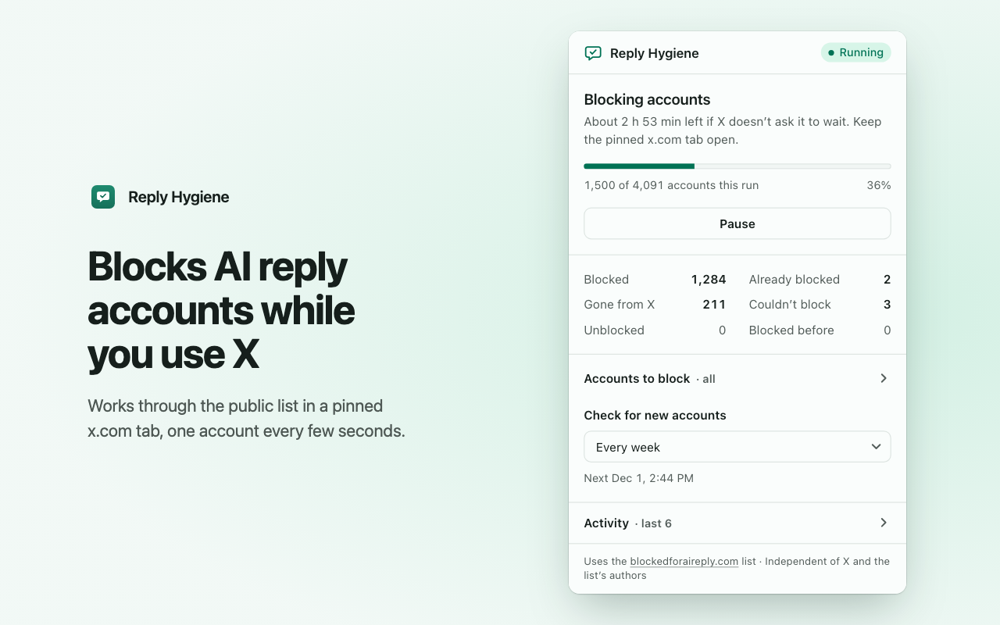
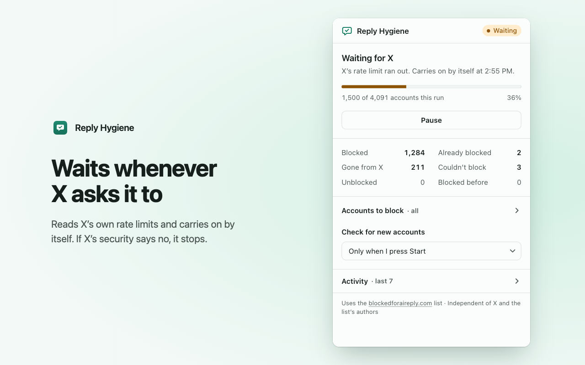
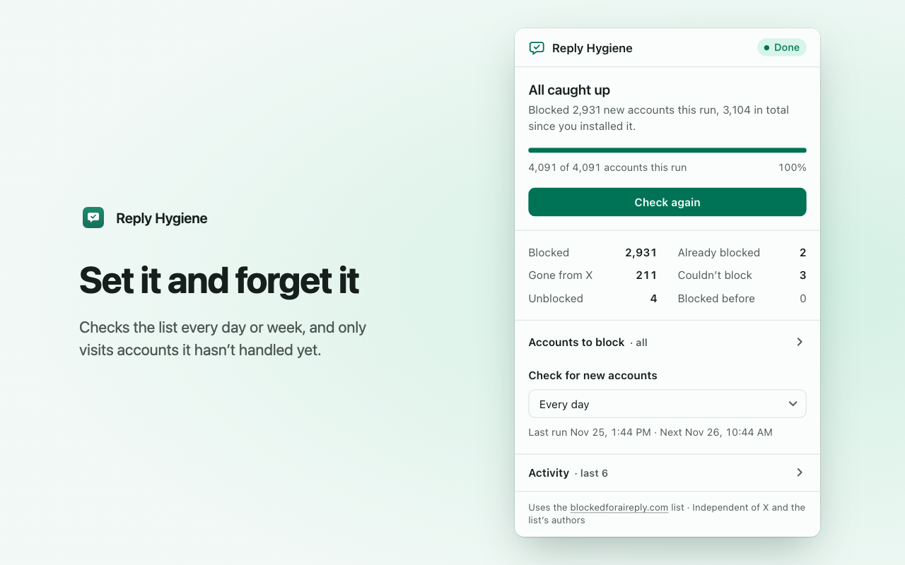
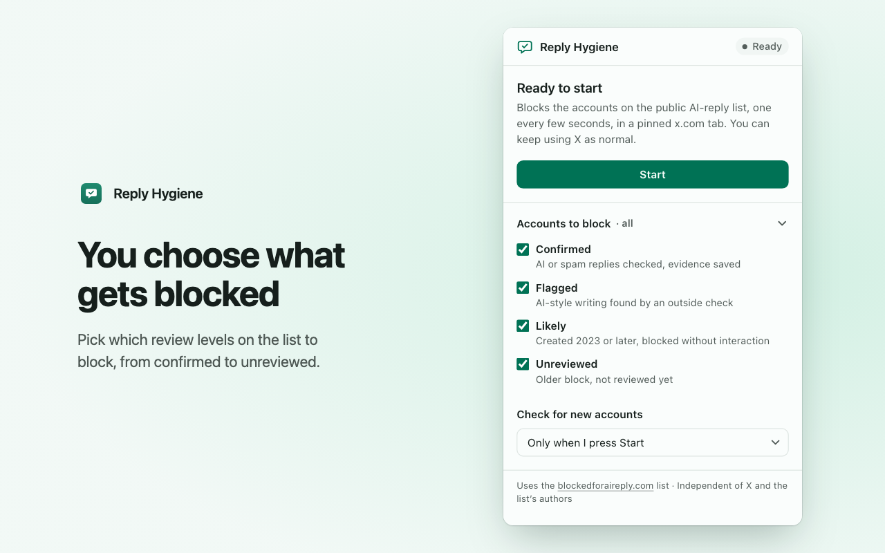
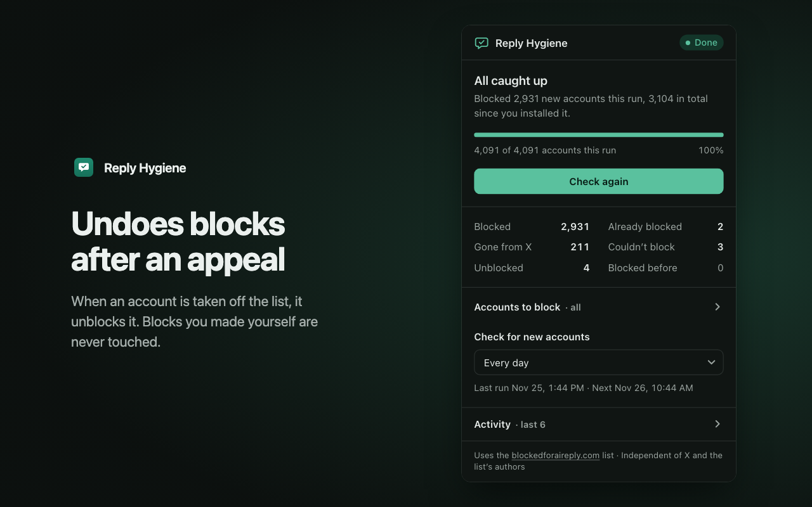
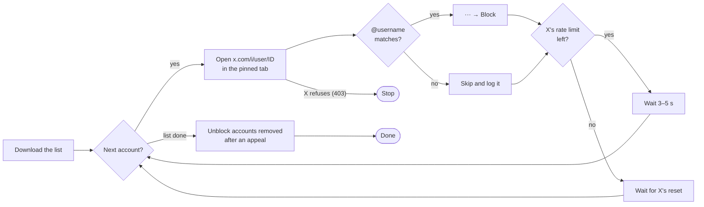
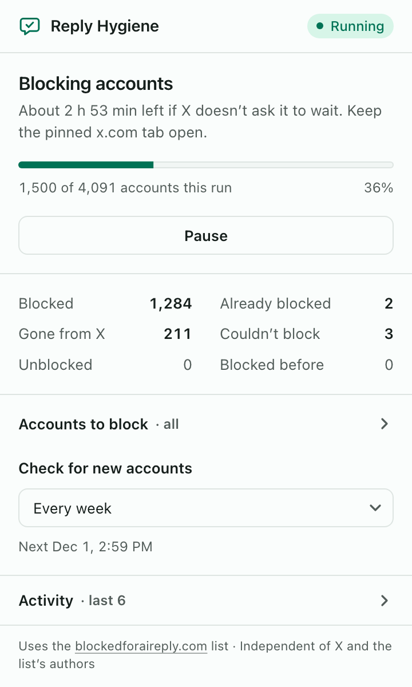

<div align="center">


# Reply Hygiene

**Clear AI reply accounts out of X, without babysitting it.**

A Chrome extension that blocks every account on the public [blockedforaireply.com](https://blockedforaireply.com) list, one at a time, slowly and within X's rate limits.

[](https://cyrisxd.github.io/reply-hygiene/)
[](extension/manifest.json)
[](LICENSE)
[](https://github.com/sponsors/CyrisXD)

[Website](https://cyrisxd.github.io/reply-hygiene/) · [Privacy](https://cyrisxd.github.io/reply-hygiene/privacy.html) · [Report a bug](https://github.com/CyrisXD/reply-hygiene/issues)

<br>



</div>

## Why

Replies on X fill up with accounts that post AI-written or spam replies. [blockedforaireply.com](https://blockedforaireply.com) keeps a reviewed, public list of them. Reply Hygiene blocks that whole list from your own account, in a pinned tab you never have to look at, and keeps up as the list grows.

## Features

<table>
<tr>
<td width="50%" valign="top">

### Careful with your account
- One account every 3 to 5 seconds, never faster
- Reads X's own rate limits and waits until X says it can carry on
- Stops instead of retrying if X's security refuses a request
- Only blocks. Never follows, likes, replies, reports or messages

</td>
<td width="50%" valign="top">

### Set it and forget it
- Progress is saved and survives browser restarts
- Checks the list every day or week, or only when you press Start
- Only visits accounts it hasn't handled yet
- Pick which review levels to block: Confirmed, Flagged, Likely, Unreviewed

</td>
</tr>
<tr>
<td width="50%" valign="top">

### Fair to people who appeal
When an account is taken off the list after an appeal, Reply Hygiene unblocks it, but only if Reply Hygiene blocked it. Blocks you made yourself are never undone.

</td>
<td width="50%" valign="top">

### Private
No server, no account, no analytics. Settings and progress stay in your browser. It only talks to x.com and to blockedforaireply.com to download the list.

</td>
</tr>
</table>

## Screenshots

<table>
<tr>
<td></td>
<td></td>
</tr>
<tr>
<td></td>
<td></td>
</tr>
</table>

## Install

**Chrome Web Store:** in review. The [website](https://cyrisxd.github.io/reply-hygiene/) will link to it as soon as it's live.

**From source:**

1. Clone this repo, open `chrome://extensions` and turn on **Developer mode**.
2. Click **Load unpacked** and pick the `extension` folder.
3. Be logged in to x.com, click the extension icon, choose which review levels to block, and press **Start**.

It opens a pinned x.com tab and works there. Leave that tab alone and use X in other tabs as normal.

## How it works

Every account goes through the same loop, one at a time:



<table>
<tr>
<td width="300" valign="top">
<picture>
  <source media="(prefers-color-scheme: dark)" srcset="docs/assets/popup-running-dark.png">
  
</picture>
</td>
<td valign="top">

**`background.js`** runs the queue. It downloads `accounts.json` and `removed.json`, saves progress in `chrome.storage.local`, and paces each step.

**`content.js`** works the pinned tab. It opens `x.com/i/user/ID`, checks the @username, and clicks ··· → Block @username → Block, the same as you would.

**`hook.js`** runs in the page and reads only the rate-limit headers on X's own API responses, so the extension waits exactly as long as X asks.

**`popup.*`** is what you see: run state, progress, counts, settings and activity.

**Remembering what it's done:** blocked accounts are skipped for good, including any you unblocked yourself since. Suspended or deleted accounts are checked again after 30 days. On an error it waits 15 minutes and retries twice.

</td>
</tr>
</table>

## Repository

```
extension/   the Chrome extension (load unpacked, or zip for the store)
docs/        the website, served by GitHub Pages
```

Package for the Chrome Web Store:

```bash
cd extension && zip -r ../reply-hygiene.zip . -x '.*'
```

## Know before you run it

> [!WARNING]
> X treats fast automated browsing as unusual activity. In testing, X's Cloudflare security started refusing profile lookups after about a dozen fast automated profile opens. Reply Hygiene goes slowly and stops when X refuses, but it can still get your session or IP temporarily blocked by X. Use it at your own risk.

## Support the project

Reply Hygiene is free, with no ads and no paid tier. If it saves you some scrolling, you can [sponsor it on GitHub](https://github.com/sponsors/CyrisXD) to help cover the time spent keeping it working as X changes.

## License

[MIT](LICENSE). Reply Hygiene is independent of X Corp. and of the authors of blockedforaireply.com.
